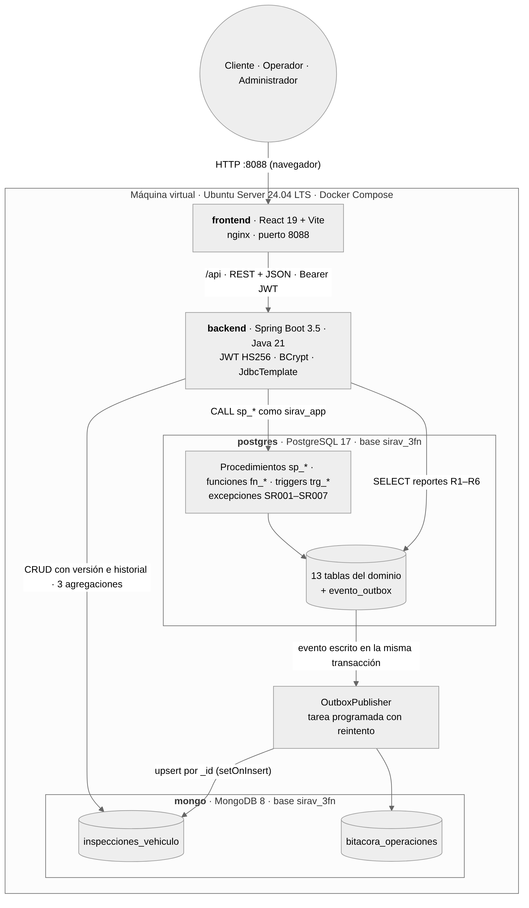
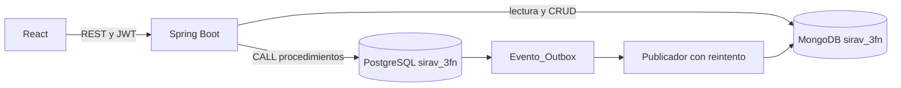

# Arquitectura simplificada

React consume una API Spring Boot. PostgreSQL conserva las 13 entidades y ejecuta los procedimientos, funciones y triggers. MongoDB conserva inspecciones con listas de daños/evidencias y la bitácora de cambios de estado.

El cliente con cuenta tiene una sola fuente de identidad: USUARIO. CLIENTE guarda su perfil; la vista v_cliente_contacto compone la lectura sin copiar datos. Clientes de mostrador guardan la identidad en CLIENTE, sin usuario asociado.

Las reservas usan intervalos [inicio, fin). Una exclusión GiST impide solapamientos y los triggers protegen cruces con mantenimiento. Los procedimientos bloquean el vehículo, aplican la regla y registran auditoría. Spring confirma la operación completa o revierte ante una excepción. La clave de idempotencia evita duplicar una reserva al reintentar.

La entrega y devolución incluyen inspección obligatoria. Su documento se guarda temporalmente en una tabla técnica outbox dentro de la misma transacción SQL. El publicador lo escribe en MongoDB por UUID con setOnInsert y reintenta si falla. La consulta/corrección de inspecciones y sus agregaciones operan en MongoDB. La corrección usa versión e historial; la eliminación es una anulación lógica.

BCrypt protege contraseñas. JWT expira a los 30 minutos; logout incrementa token_version y revoca la sesión. El servidor limita cada cliente a sus propias operaciones. ADMIN gestiona catálogo y tarifas; ADMIN/OPERADOR gestionan entregas, mantenimiento e inspecciones. El usuario SQL de la API no escribe directamente reservas, alquileres ni pagos.

El backend conserva módulos de seguridad, catálogo, alquiler, inspecciones y reportes. El frontend comparte formulario, tabla, diálogo y campos de inspección. No hay dashboard ni administración avanzada de usuarios.
