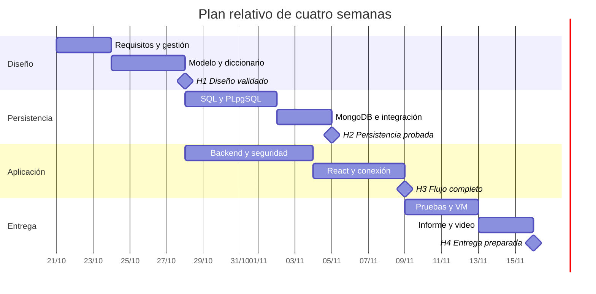
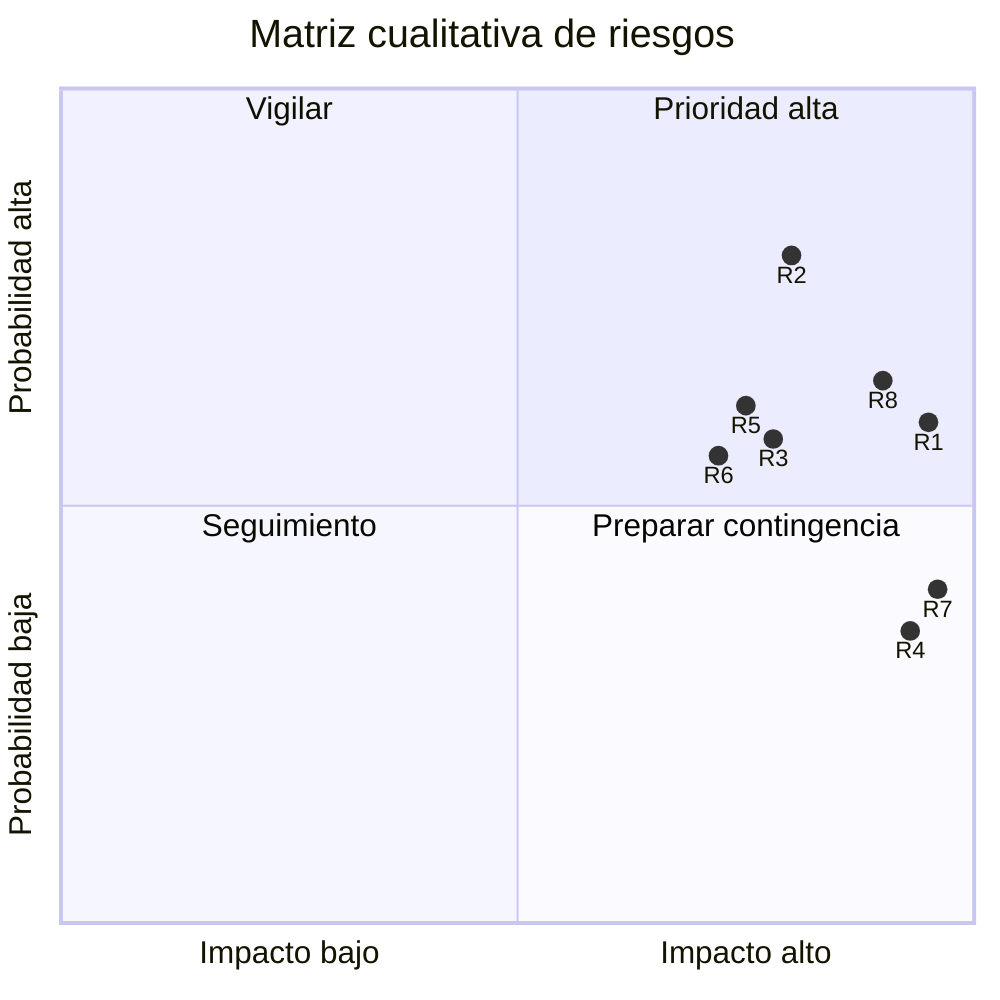

# Plan de gestión del proyecto

Este documento es un plan ejecutable, no un registro de actividades ya realizadas por el equipo. El documento oficial solicita tres estudiantes; asignar sus nombres y validar con el docente cualquier excepción antes de entregar. Las fechas se expresan de forma relativa para ajustarlas al calendario oficial.

## Alcance y supuestos

El prototipo centraliza clientes, flota, reservas, alquileres, mantenimiento, inspecciones y cobros simulados de una empresa pequeña. No incluye pagos reales, aplicación móvil, telemetría, geolocalización en tiempo real, cálculo automático de daños ni facturación electrónica. Se asume una sola operación con fechas de negocio de Bogotá y moneda COP. El combustible se representa de 0 a 100. Las evidencias son referencias; no se implementa almacenamiento de fotografías.

Una reserva utiliza una tarifa que cubra todo su intervalo y cuenta días como fecha fin menos fecha inicio. La reserva solicitada bloquea el período. Las entregas se hacen dentro del intervalo reservado. La inspección puede tener cero daños. Las cancelaciones solo ocurren antes de la entrega. Un retraso se calcula por días calendario, no por bloques de 24 horas. Los pagos se registran al cerrar.

## Metodología

Se propone un enfoque híbrido: cerrar modelo y reglas en la primera etapa; después trabajar con iteraciones semanales y tablero Kanban. Cada historia debe incluir criterio verificable, responsable, prueba y vínculo al cambio de código. La revisión semanal comprueba la aplicación ejecutada y ajusta el backlog. El equipo debe conservar las decisiones reales; no basta con copiar este plan.

## Descomposición del trabajo y estimaciones

| EDT | Trabajo | Horas propuestas | Entregable |
| --- | --- | --- | --- |
| 1.1 | Requisitos, propuesta y supuestos | 8 | Alcance validado |
| 1.2 | Modelos, normalización y diccionario | 10 | Diseño de datos |
| 1.3 | Plan, RACI, cronograma y riesgos | 4 | Gestión aprobada |
| 2.1 | Esquema, restricciones y datos | 8 | Base inicializada |
| 2.2 | Procedimientos, funciones y triggers | 14 | Ciclo SQL probado |
| 2.3 | Consultas de reportes y privilegios | 6 | Reportes y roles |
| 3.1 | API, JWT y autorización | 12 | Backend integrado |
| 3.2 | React y flujos operativos | 14 | Interfaz funcional |
| 3.3 | MongoDB, outbox, CRUD y agregaciones | 12 | Integración documental |
| 4.1 | VM, respaldo y despliegue | 8 | Evidencia Linux |
| 4.2 | Pruebas, correcciones e informe | 12 | Entrega verificada |
| 4.3 | Video y preparación de sustentación | 6 | Video y ensayo |

Total propuesto: 124 horas. Repartir aproximadamente 41–42 horas por estudiante y revisar según disponibilidad real.

## Cronograma y hitos

El inicio del diagrama es una referencia de planificación del 21 de octubre de 2026, no una fecha oficial de entrega ni evidencia de ejecución. Ajustar dependencias y fechas al calendario del curso.

## RACI y reparto propuesto

I1: datos relacionales y reglas. I2: API, seguridad y calidad. I3: frontend, MongoDB e infraestructura. Los roles pueden rotar por iteración.

| Actividad | I1 | I2 | I3 |
| --- | --- | --- | --- |
| Alcance y requisitos | A/R | C | C |
| Modelo y diccionario | A/R | C | R |
| Procedimientos e integridad | A/R | R | C |
| API y autorización | C | A/R | C |
| React y accesibilidad | C | C | A/R |
| MongoDB e integración | C | R | A/R |
| Pruebas de concurrencia y seguridad | R | A/R | R |
| VM y respaldos | C | R | A/R |
| Informe y referencias | A/R | R | R |
| Video y sustentación | R | A | R |

A responde por el resultado; R ejecuta; C es consultado. Asignar una persona real por cada columna.

## Riesgos

Escala probabilidad e impacto de 1 a 5; exposición = P × I. Exposición alta a partir de 12.

| ID | Riesgo | P | I | Exposición | Mitigación | Responsable propuesto |
| --- | --- | --- | --- | --- | --- | --- |
| R1 | Concurrencia permite doble reserva | 3 | 5 | 15 | Exclusión, bloqueos y prueba simultánea real | I1 |
| R2 | Diferencias entre SQL y documentos | 4 | 4 | 16 | Outbox idempotente, contador de pendientes y reintentos | I2 |
| R3 | Memoria insuficiente en VM | 3 | 4 | 12 | Probar con recursos asignados y limitar servicios de muestra | I3 |
| R4 | Pérdida de datos o VM | 2 | 5 | 10 | Respaldos fuera de la VM y restauración de ensayo | I3 |
| R5 | Falta de participación de un miembro | 3 | 4 | 12 | Revisión semanal, tareas visibles y respaldo cruzado | Todos |
| R6 | Cambios de alcance tardíos | 3 | 4 | 12 | Congelar MVP y negociar ampliaciones | I1 |
| R7 | Exposición de secretos | 2 | 5 | 10 | .env ignorado, secretos por entorno y revisión Git | I2 |
| R8 | Entregables incompatibles con la rúbrica | 3 | 5 | 15 | Usar el PDF definitivo y verificar checklist antes de entregar | Todos |

## Git y trazabilidad colaborativa

Crear un repositorio remoto real. Trabajar en ramas `codex/RF-xx-descripcion` o ramas del equipo equivalentes; commits descriptivos como `feat(RF-08): impedir reservas solapadas`. Cada integrante debe aportar cambios propios y revisiones. Abrir PR con alcance y validación. Configurar checks obligatorios si usan GitHub.

La plantilla `docs/trazabilidad.csv` vincula requisitos, historias, rama/commit, PR y evidencia. Los campos de actividad del equipo están vacíos deliberadamente: deben llenarse con hechos verificables. El proyecto incluye un pipeline de pruebas, pero no se afirma que haya ejecutado un workflow en un remoto inexistente.
