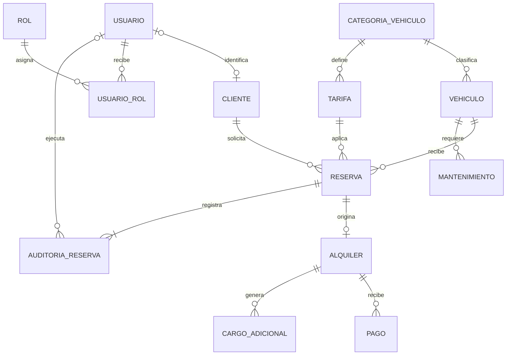
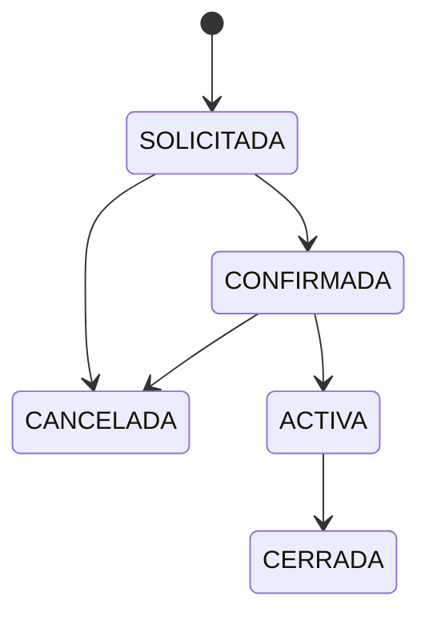

# Modelo de datos revisado

La definición ejecutable es `database/postgres/01-schema.sql`. Los diagramas de la entrega final (Chen, EER, Crow's Foot lógico y relacional) están en `docs/diagramas/` y se generaron del catálogo de esta base; el diccionario con la verificación de 3FN está en `docs/fase-1/diccionario-datos.md`.

Si CLIENTE.id_usuario no es NULL, CLIENTE.nombres/apellidos/email deben ser NULL. Si id_usuario es NULL, se requieren nombres y apellidos en CLIENTE. v_cliente_contacto no es una entidad adicional: es una vista que reúne la identidad desde la fuente correspondiente.

La tabla técnica evento_outbox coordina la publicación de documentos en MongoDB; no se cuenta como entidad del dominio de alquiler.
