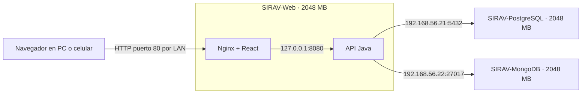

# SIRAV completo en tres máquinas virtuales

El frontend y la API se alojan en **SIRAV-Web**, una tercera VM Ubuntu Server 24.04 LTS con 2 GB de RAM, 2 CPU y disco dinámico de 20 GB. Nginx sirve la compilación de React y reenvía `/api` a Java, que consulta las dos VM de bases de datos. Para usar la aplicación ya no hace falta ejecutar Java o Vite en Windows.

## Abrir la aplicación

Desde un computador, celular o tableta conectado a la misma red local:

**http://192.168.1.18**

En este equipo Windows también puedes usar **http://localhost:8088** o **http://192.168.56.23**. No se requiere instalar nada en los dispositivos que abren el navegador.

La dirección `192.168.1.18` fue asignada por el DHCP de la red Wi-Fi. Si cambia al conectarte a otra red, consulta la dirección nueva con `manage-web-vm.ps1 -Action Check`. Para conservarla en esta red se puede reservar una IP en el router para la MAC `08:00:27:a3:23:02`.

Este acceso corresponde a la red local. El acceso por Internet requiere configurar un dominio o una dirección pública y HTTPS, o un túnel autorizado. Esta instalación no configura el router para publicar servicios en Internet.



La VM web usa NAT para Internet y SSH de administración, un adaptador solo-anfitrión para las bases y un adaptador puente sobre `Intel(R) Wi-Fi 6E AX211 160MHz` para los navegadores de la red local. La API escucha en 127.0.0.1 dentro de la VM y Nginx publica el acceso web en el puerto 80. Los navegadores utilizan rutas `/api` del mismo servidor; no deben conectarse a PostgreSQL o MongoDB.

## Encender, consultar y apagar

En PowerShell, desde la raíz del proyecto:

```powershell
powershell -NoProfile -ExecutionPolicy Bypass -File scripts/manage-sirav-vms.ps1 -Action Start
powershell -NoProfile -ExecutionPolicy Bypass -File scripts/manage-sirav-vms.ps1 -Action Status
powershell -NoProfile -ExecutionPolicy Bypass -File scripts/manage-sirav-vms.ps1 -Action Check
powershell -NoProfile -ExecutionPolicy Bypass -File scripts/manage-sirav-vms.ps1 -Action Stop
```

Estos comandos operan exclusivamente las tres VM `SIRAV-*`. El arranque en este equipo puede tardar varios minutos por el modo de virtualización NEM. Espera a que las bases y la web estén listas antes de iniciar sesión.

Durante la auditoría se observó un arranque de API de aproximadamente 11 minutos; el despliegue espera hasta 15 minutos. El [informe de pruebas y concurrencia](AUDITORIA-FUNCIONAL-VM.md) registra las correcciones aplicadas y los resultados.

Para revisar solamente la web:

```powershell
powershell -NoProfile -ExecutionPolicy Bypass -File scripts/manage-web-vm.ps1 -Action Check
powershell -NoProfile -ExecutionPolicy Bypass -File scripts/manage-web-vm.ps1 -Action Diagnose
ssh -i .runtime/virtualbox/id_ed25519 -p 2223 sirav@127.0.0.1
```

El usuario Linux es `sirav`. Las credenciales de consola se conservan localmente en `.runtime/virtualbox/access.json`. Las credenciales de las bases y JWT se toman del `.env` del proyecto y se instalan en `/opt/sirav/application.env`, accesible solo por root. No se incluyen en los archivos públicos de React.

## Actualizar la aplicación

Si modificas el backend, compílalo primero:

```powershell
mvn -f backend/pom.xml verify
```

Para compilar el frontend y desplegar ambas partes:

```powershell
powershell -NoProfile -ExecutionPolicy Bypass -File scripts/deploy-web-vm.ps1
```

El despliegue copia los archivos compilados a una nueva carpeta en `/opt/sirav/releases`, actualiza `/opt/sirav/current`, valida Nginx y espera que `/actuator/health` responda `UP`. Conserva las versiones anteriores y los archivos de evidencias en `/opt/sirav/evidencias`. No modifica ni reinicializa los datos de las bases.

Java se administra con `sirav-api.service`, con heap máximo de 512 MB y reinicio automático si falla. Nginx y la API están habilitados al arrancar Ubuntu. Para diagnosticar dentro de la VM:

```bash
systemctl status nginx sirav-api --no-pager
sudo journalctl -u sirav-api -n 60 --no-pager
curl http://127.0.0.1/actuator/health
ip -4 -brief address show public0
```

Si se cambia la dirección LAN con la API ya iniciada, reinicia `sirav-api` para actualizar los orígenes permitidos. Si un celular no puede conectarse aunque use la misma Wi-Fi, comprueba que no esté en una red de invitados con aislamiento entre dispositivos.

El formulario de reservas permite el acceso por HTTP de la red local: usa `crypto.getRandomValues()` cuando `crypto.randomUUID()` no está disponible. [MDN documenta la disponibilidad de getRandomValues en HTTP](https://developer.mozilla.org/en-US/docs/Web/API/Crypto/getRandomValues).

## Verificación realizada

La VM terminó su inicialización con `cloud-init status: done`; Nginx y `sirav-api.service` están activos y `/actuator/health` responde `UP`, incluyendo las conexiones a PostgreSQL y MongoDB. Se observaron aproximadamente 567 MB usados en el invitado con 2048 MB asignados.

Desde Windows se abrió `http://192.168.1.18` en Chrome y Edge: inicio de sesión correcto, apertura del formulario de reservas por HTTP y ausencia de errores JavaScript. También se comprobó el ajuste de la pantalla de acceso a una vista de 390 píxeles. Las cinco pruebas automatizadas del frontend y la compilación de producción terminaron correctamente. Las tres VM quedaron encendidas.
