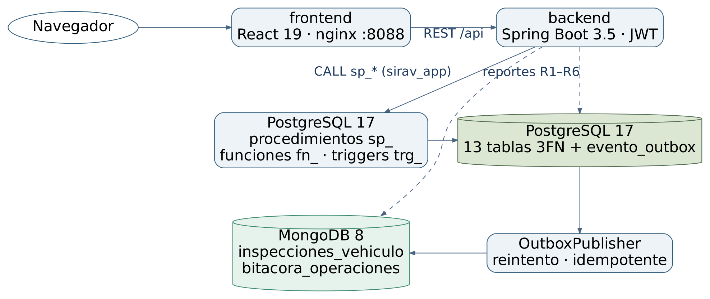

# Guía de instalación, puertos, arranque y respaldos — SIRAV

Historias de Jira: **SIRAV-15** (VM con Ubuntu Server) y **SIRAV-35** (instalación, puertos, arranque y copias de respaldo). La guía instala SIRAV completo en una máquina virtual **Ubuntu Server 24.04 LTS** con **Docker Compose**. La justificación de estas elecciones está en [`seleccion-so-rdbms.md`](seleccion-so-rdbms.md).

> **Estado de verificación.** Los pasos 4 a 8 se ejecutan automáticamente en un Ubuntu 24.04 limpio en cada cambio, con el workflow [`despliegue.yml`](../../.github/workflows/despliegue.yml): construcción, arranque, verificación de punta a punta, respaldo, restauración y reinicio. El resultado está en la sección 9. La creación de la VM (pasos 1 a 3) la hace el equipo en su computador.



## 1. Crear la máquina virtual

Con VirtualBox 7 (o VMware Workstation Player; los pasos son equivalentes):

| Parámetro | Recomendado | Mínimo |
|---|---|---|
| Sistema | Ubuntu 64-bit | |
| Memoria | 6 GB | 4 GB |
| Procesadores | 2 núcleos | 2 núcleos |
| Disco | 40 GB, dinámico | 25 GB |
| Red | Adaptador 1: NAT con reenvío de puertos (ver la sección 5) | |

Descargar la ISO de **Ubuntu Server 24.04 LTS** desde https://ubuntu.com/download/server y montarla en la unidad óptica de la VM.

## 2. Instalar Ubuntu Server

En el instalador:

1. Idioma English o Español, teclado Latin American.
2. Tipo de instalación: **Ubuntu Server** (no la versión minimizada).
3. Red: DHCP (automática).
4. Disco: usar todo el disco con LVM.
5. Perfil: nombre `sirav`, servidor `sirav-vm`, usuario `sirav`.
6. Marcar **Install OpenSSH server**.
7. No seleccionar snaps adicionales (Docker se instala desde su repositorio oficial).

Al terminar, reiniciar y actualizar el sistema:

```bash
sudo apt update && sudo apt -y full-upgrade
sudo timedatectl set-timezone America/Bogota
sudo reboot
```

## 3. Instalar Docker Engine y Compose

Repositorio oficial de Docker (https://docs.docker.com/engine/install/ubuntu/):

```bash
sudo apt -y install ca-certificates curl git
sudo install -m 0755 -d /etc/apt/keyrings
sudo curl -fsSL https://download.docker.com/linux/ubuntu/gpg -o /etc/apt/keyrings/docker.asc
sudo chmod a+r /etc/apt/keyrings/docker.asc
echo "deb [arch=$(dpkg --print-architecture) signed-by=/etc/apt/keyrings/docker.asc] https://download.docker.com/linux/ubuntu $(. /etc/os-release && echo "$VERSION_CODENAME") stable" \
  | sudo tee /etc/apt/sources.list.d/docker.list > /dev/null
sudo apt update
sudo apt -y install docker-ce docker-ce-cli containerd.io docker-buildx-plugin docker-compose-plugin
sudo usermod -aG docker $USER      # cerrar sesión y volver a entrar
sudo systemctl enable --now docker # Docker arranca con el sistema
docker --version && docker compose version
```

## 4. Descargar y configurar SIRAV

```bash
git clone https://github.com/DavidBejarano309/SIRAV.git ~/sirav
cd ~/sirav
bash scripts/configure.sh
```

`configure.sh` crea el archivo `.env` con permisos 600 y contraseñas aleatorias de 48 caracteres hexadecimales. `.env` está en `.gitignore` y nunca se sube al repositorio.

| Variable | Para qué |
|---|---|
| `POSTGRES_PASSWORD` | Usuario dueño `sirav_owner` de PostgreSQL |
| `DB_PASSWORD` | Usuario de la aplicación `sirav_app` en PostgreSQL |
| `MONGO_ROOT_PASSWORD` | Usuario `root` de MongoDB (solo administración y respaldos) |
| `MONGO_PASSWORD` | Usuario de la aplicación `sirav_app` en MongoDB |
| `JWT_SECRET` | Clave HMAC con la que se firman los tokens |
| `SEED_DEMO`, `DEMO_PASSWORD` | Crea las cuentas `admin@`, `operador@` y `cliente@sirav.local` con esa contraseña (demostración) |

## 5. Arrancar

```bash
docker compose -f compose.yaml -f compose.vm.yaml up --build -d
docker compose ps
```

La primera vez tarda varios minutos, porque construye el backend (Maven) y el frontend (npm). Docker crea los volúmenes y ejecuta una sola vez:

- `database/postgres/init.sh`: crea el usuario `sirav_app` y corre `01-schema.sql` a `05-permissions.sql`.
- `database/mongo/init.js`: crea el usuario, las colecciones, el validador y los índices.

`compose.vm.yaml` publica la interfaz web en el puerto 8088 de **todas** las interfaces de la VM. `compose.yaml` por sí solo la publica únicamente en `127.0.0.1`, lo que sirve para un portátil pero no para entrar desde el anfitrión.

**Puertos**

| Servicio | Puerto en el contenedor | Publicado en la VM | Acceso |
|---|---|---|---|
| frontend (nginx) | 80 | **8088** | Navegador. nginx reenvía `/api/` y `/actuator/health` al backend |
| backend (Spring Boot) | 8080 | No | Solo desde nginx, por la red interna de Docker |
| postgres | 5432 | No | Solo backend y administración con `docker compose exec` |
| mongo | 27017 | No | Solo backend y administración con `docker compose exec` |
| SSH | 22 | Sí (sistema) | Administración de la VM |

**Entrar desde el equipo anfitrión.** En VirtualBox, en Configuración → Red → Adaptador 1 (NAT) → Avanzado → Reenvío de puertos, agregar dos reglas:

| Nombre | Protocolo | Puerto anfitrión | Puerto invitado |
|---|---|---|---|
| sirav-web | TCP | 8088 | 8088 |
| ssh | TCP | 2222 | 22 |

Luego abrir **http://localhost:8088** en el navegador del anfitrión y conectarse por SSH con `ssh -p 2222 sirav@localhost`. Con adaptador puente, en cambio, se usa la IP de la VM (`ip -4 addr`), es decir `http://IP-de-la-VM:8088`.

Si se activa el cortafuegos de Ubuntu:

```bash
sudo ufw allow OpenSSH && sudo ufw allow 8088/tcp && sudo ufw enable
```

Docker publica sus puertos por encima de `ufw`, así que no se debe publicar ningún puerto de las bases.

## 6. Verificar

```bash
bash scripts/verificar-despliegue.sh
```

El script usa la cuenta `operador@sirav.local` y recorre el flujo completo a través de nginx:

1. Salud del backend e inicio de sesión.
2. Catálogo.
3. Reserva válida y reserva solapada, que debe rechazarse con 409.
4. Confirmación, entrega y devolución con inspecciones.
5. Pago simulado y auditoría.
6. Publicación de las inspecciones en MongoDB, consulta `$elemMatch` y agregaciones.
7. Los seis reportes.

Termina con `Verificación completa: todo correcto`. Deja una reserva cerrada de demostración.

Cuentas de demostración: `admin@sirav.local`, `operador@sirav.local` y `cliente@sirav.local`, con la contraseña de `DEMO_PASSWORD` en `.env`.

## 7. Arranque, parada y registros

| Acción | Comando |
|---|---|
| Ver estado | `docker compose ps` |
| Ver registros del backend | `docker compose logs -f backend` |
| Detener sin borrar datos | `docker compose stop` |
| Volver a iniciar | `docker compose -f compose.yaml -f compose.vm.yaml up -d` |
| Actualizar a una versión nueva del repositorio | `git pull && docker compose -f compose.yaml -f compose.vm.yaml up --build -d` |
| Consola SQL | `docker compose exec postgres psql -U sirav_owner -d sirav_3fn` |
| Consola MongoDB | `docker compose exec mongo sh -c 'mongosh -u root -p "$MONGO_INITDB_ROOT_PASSWORD" --authenticationDatabase admin sirav_3fn'` |
| **Borrar todo, incluidos los datos** | `docker compose down -v` (irreversible) |

**Arranque automático.**

- El servicio `docker` está habilitado en systemd (paso 3).
- Los cuatro contenedores tienen `restart: unless-stopped`.
- Al reiniciar la VM, todo vuelve a levantarse sin intervención y los datos persisten en los volúmenes `postgres_3fn_data` y `mongo_3fn_data`.
- El backend espera a que las dos bases estén sanas (`depends_on: condition: service_healthy`).

## 8. Copias de respaldo y restauración

**Respaldo manual:**

```bash
bash scripts/backup.sh
```

Crea `backups/AAAAMMDD-HHMMSS/` (permisos 700) con dos archivos:

- `postgres.dump`: `pg_dump` en formato personalizado (`-Fc`) de `sirav_3fn`.
- `mongodb.archive.gz`: `mongodump` comprimido de `sirav_3fn`.

**Respaldo diario automático** (2:30 a. m.), conservando 14 días:

```bash
crontab -e
# agregar:
30 2 * * * cd ~/sirav && bash scripts/backup.sh >> backups/cron.log 2>&1 && find backups -mindepth 1 -maxdepth 1 -type d -mtime +14 -exec rm -rf {} +
```

**Restaurar sobre la base en uso** (detiene la aplicación mientras tanto):

```bash
cd ~/sirav && dir=backups/AAAAMMDD-HHMMSS
docker compose stop backend frontend
docker compose exec -T postgres sh -c 'dropdb -U sirav_owner sirav_3fn && createdb -U sirav_owner sirav_3fn'
docker compose exec -T postgres pg_restore -U sirav_owner -d sirav_3fn < $dir/postgres.dump
docker compose exec -T mongo sh -c 'mongorestore -u root -p "$MONGO_INITDB_ROOT_PASSWORD" --authenticationDatabase admin --archive --gzip --drop' < $dir/mongodb.archive.gz
docker compose -f compose.yaml -f compose.vm.yaml up -d
```

Para probar un respaldo sin tocar la base en uso, se restaura en otra base. Esto es lo que hace el paso 8 de `despliegue.yml`:

- PostgreSQL: `createdb sirav_restaurada` y luego `pg_restore -d sirav_restaurada`.
- MongoDB: `mongorestore --nsFrom "sirav_3fn.*" --nsTo "sirav_restaurada.*"`.

Además de los respaldos lógicos, conviene tomar una **instantánea de la VM** en VirtualBox (Máquina → Tomar instantánea) antes de cada demostración.

## 9. Resultado de la verificación automática

Ejecución del 11 de noviembre de 2026, de 19:05 a 19:07 hora de Bogotá ([run 43124722316](https://github.com/DavidBejarano309/SIRAV/actions/runs/43124722316)), en Ubuntu 24.04.5 LTS con Docker 28.0.4 y Compose v2.38.2. Salida completa en [`docs/evidencias/despliegue-docker.txt`](../evidencias/despliegue-docker.txt).

| Paso | Resultado |
|---|---|
| Construcción y arranque con `compose.vm.yaml` | Cuatro servicios en marcha; solo `frontend` publica un puerto (`0.0.0.0:8088->80`) |
| `verificar-despliegue.sh` | 14 de 14 comprobaciones correctas. Incluye la reserva solapada rechazada con 409 (`El vehículo no está disponible en esas fechas`), el pago `SIMULADO APROBADO 240000`, la auditoría `SOLICITADA -> CONFIRMADA -> ACTIVA -> CERRADA` y 2 inspecciones publicadas en MongoDB |
| `backup.sh` | `postgres.dump` (139 KB) y `mongodb.archive.gz`, ambos con permisos 600 |
| Restauración en bases nuevas | PostgreSQL: 1 reserva, 1 alquiler y 1 pago, igual que el original. MongoDB: 2 inspecciones y 4 eventos, igual que el original |
| `docker compose restart` | La aplicación vuelve a responder y conserva los datos (1 reserva) |

**Errores que encontró esta verificación y ya están corregidos:**

- Las cuentas de demostración se crean aproximadamente un segundo después de que el backend reporta que está en línea. Un inicio de sesión en ese instante se rechaza. El script lo reintenta; un usuario solo tendría que volver a intentar.
- Un respaldo tomado en los primeros segundos después de una devolución puede no incluir aún su inspección en MongoDB, porque el publicador trabaja cada 2 s. El dato no se pierde: queda en `evento_outbox`, que sí se respalda, y se publica al restaurar.

## 10. Problemas frecuentes

| Síntoma | Causa probable | Solución |
|---|---|---|
| `Configure .env` al arrancar | No se ejecutó `configure.sh` | `bash scripts/configure.sh` |
| El navegador del anfitrión no abre la página | Falta `compose.vm.yaml` o la regla de reenvío de puertos | Arrancar con los dos archivos (sección 5) y revisar la regla `sirav-web` |
| El backend se reinicia con `Unauthorized` de MongoDB | Volumen de MongoDB creado con otra contraseña o con una versión anterior de `init.js` | Respaldar y luego `docker compose down -v` (borra los datos) y volver a levantar |
| La página carga, pero el inicio de sesión falla | `SEED_DEMO=false` o contraseña distinta | Revisar `SEED_DEMO` y `DEMO_PASSWORD` en `.env` |
| `permission denied` en `docker` | El usuario no está en el grupo `docker` | `sudo usermod -aG docker $USER` y volver a iniciar sesión |
| Las inspecciones tardan en aparecer | El publicador outbox trabaja cada 2 s, o MongoDB no responde | `docker compose logs backend`; `/api/inspections/analytics` muestra los pendientes |

## 11. Evidencias para la entrega

Capturas que conviene guardar en `docs/evidencias/vm/`:

- [ ] Configuración de la VM en VirtualBox (memoria, CPU, disco y reenvío de puertos).
- [ ] `lsb_release -a`, `docker --version` y `docker compose version` dentro de la VM.
- [ ] `docker compose ps` con los cuatro servicios `running`/`healthy`.
- [ ] Salida de `bash scripts/verificar-despliegue.sh`.
- [ ] Navegador del anfitrión en `http://localhost:8088` con la sesión iniciada.
- [ ] `bash scripts/backup.sh` y el contenido de la carpeta `backups/`.
- [ ] `sudo reboot` y, al volver, `docker compose ps` con los servicios arriba otra vez.
