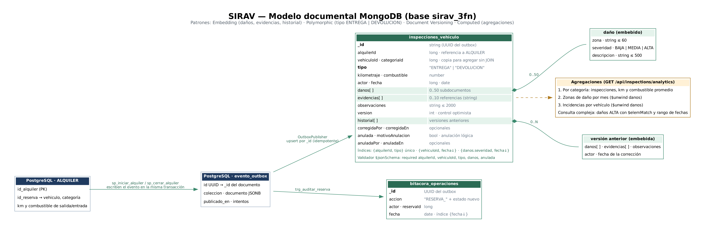

# Modelo documental de MongoDB — SIRAV

Historias de Jira: **SIRAV-23** (modelo y justificación), **SIRAV-25** (colecciones y CRUD) y **SIRAV-26** (consulta compleja y agregaciones). MongoDB 8.0 guarda dos colecciones en la base `sirav_3fn`: **`inspecciones_vehiculo`** y **`bitacora_operaciones`**. Las crea `database/mongo/init.js` y la aplicación las usa desde `backend/.../inspection/`.



## 1. Por qué NoSQL para estos datos

| | PostgreSQL | MongoDB |
|---|---|---|
| Qué guarda | Reservas, alquileres, pagos, cargos, tarifas, vehículos, usuarios y auditoría de estados | Inspecciones de entrega y devolución, y bitácora de eventos |
| Naturaleza del dato | Estructurado, con relaciones e integridad transaccional | Estructura variable que se lee como documento completo |
| Reglas | RN-01 a RN-05 en restricciones, procedimientos y triggers | Validador `$jsonSchema`, índice único y validación en la API |
| Papel | **Fuente única de verdad** del negocio | Registro documental complementario |

- **Inspecciones.** Cada inspección tiene cero o muchos daños (zona, severidad y descripción) y una lista variable de evidencias. Además, cada corrección conserva la versión anterior. En SQL serían cuatro tablas (inspección, daño, evidencia y versión) que siempre se consultan juntas; en MongoDB es un solo documento que se lee y se escribe de una vez.
- **Bitácora.** Es de escritura continua, no tiene relaciones y solo se consulta por fecha.
- **Lo que no va en MongoDB.** El estado oficial de reservas y alquileres, los pagos y la auditoría transaccional se quedan en PostgreSQL. La bitácora es una proyección de `auditoria_reserva`, no su reemplazo.

## 2. Colección `inspecciones_vehiculo`

Documento de ejemplo (devolución corregida una vez):

```json
{
  "_id": "6f1d0c2e-4b8a-4c51-9a77-1f0e2d3c4b5a",
  "alquilerId": 12, "vehiculoId": 3, "categoriaId": 2,
  "tipo": "DEVOLUCION",
  "kilometraje": 15320, "combustible": 80,
  "actor": 2, "fecha": { "$date": "2026-11-11T15:42:00Z" },
  "danos": [ { "zona": "Puerta trasera", "severidad": "ALTA", "descripcion": "Rayón de 20 cm" } ],
  "evidencias": [ "devolucion-12-puerta.jpg" ],
  "observaciones": "Cliente informa el rayón al devolver",
  "anulada": false,
  "version": 1,
  "historial": [ { "danos": [], "evidencias": [], "observaciones": "Sin novedad", "actor": 2, "fecha": { "$date": "2026-11-11T15:40:00Z" } } ],
  "corregidaPor": 2, "corregidaEn": { "$date": "2026-11-11T15:45:00Z" }
}
```

| Campo | Tipo | Origen | Descripción |
|---|---|---|---|
| `_id` | string | `evento_outbox.id` | UUID del evento; hace idempotente la publicación |
| `alquilerId` | long | `alquiler.id_alquiler` | Referencia lógica a PostgreSQL |
| `vehiculoId`, `categoriaId` | long | `vehiculo` | Copia para agrupar sin consultar PostgreSQL; no cambian durante el alquiler |
| `tipo` | string | procedimiento | `ENTREGA` (lo escribe `sp_iniciar_alquiler`) o `DEVOLUCION` (`sp_cerrar_alquiler`) |
| `kilometraje`, `combustible` | number | procedimiento | Lectura del odómetro y porcentaje del tanque en ese momento |
| `actor`, `fecha` | long, date | procedimiento | Usuario que hizo la inspección y momento |
| `danos[]` | array de subdocumentos | operador | 0 a 50 daños: `zona` (≤ 60), `severidad` (BAJA, MEDIA o ALTA) y `descripcion` (≤ 500) |
| `evidencias[]` | array de strings | operador | 0 a 10 referencias a fotos (nombre o enlace; los archivos no se guardan en la base) |
| `observaciones` | string | operador | Hasta 2000 caracteres |
| `version` | int | aplicación | Empieza en 0 y aumenta con cada corrección o anulación (control optimista) |
| `historial[]` | array de subdocumentos | aplicación | Versión anterior de daños, evidencias y observaciones en cada corrección |
| `anulada`, `motivoAnulacion`, `anuladaPor`, `anuladaEn` | bool, string, long, date | aplicación | Anulación lógica: el documento no se borra |

**Validador** (`init.js`): exige `alquilerId`, `vehiculoId`, `tipo`, `danos` y `anulada`; `tipo` ∈ {ENTREGA, DEVOLUCION}; `danos` es arreglo; `anulada` es booleano. Los límites de tamaño y la severidad los valida la API (`RentalService.Inspection` y `Damage`).

## 3. Colección `bitacora_operaciones`

```json
{ "_id": "b2c4…", "accion": "RESERVA_CONFIRMADA", "actor": 2, "reservaId": 12, "fecha": { "$date": "2026-11-11T15:30:00Z" } }
```

`trg_auditar_reserva` escribe un evento por cada creación o cambio de estado de una reserva (`RESERVA_SOLICITADA`, `RESERVA_CONFIRMADA`, `RESERVA_ACTIVA`, `RESERVA_CERRADA` o `RESERVA_CANCELADA`). Índice `{fecha: -1}`.

## 4. Patrones del capítulo 13 del manual

| Patrón | Dónde | Por qué |
|---|---|---|
| **Embedding** (13.1) | `danos[]`, `evidencias[]` e `historial[]` dentro de la inspección | Se leen siempre con la inspección y no tienen sentido solos. Una lectura trae todo y la corrección es una sola escritura atómica |
| **Polymorphic** (13.6) | Una colección para `ENTREGA` y `DEVOLUCION`, distinguidas por `tipo` | Comparten la misma forma; el índice único `{alquilerId, tipo}` garantiza una de cada tipo por alquiler (RN-05). En la bitácora, `accion` distingue los eventos |

**Otros patrones aplicados (fuera del capítulo 13):**

- **Versionado de documentos.** `version` e `historial[]`. La corrección solo se aplica si la versión que envía el cliente coincide (`updateFirst` con `{_id, version, anulada: false}`); si otro usuario corrigió antes, responde 409.
- **Referencia extendida.** Se copian `vehiculoId` y `categoriaId`, que no cambian durante un alquiler. Así las agregaciones agrupan sin consultar PostgreSQL.
- **Outbox transaccional.** Ver la sección 5.

**Patrones del manual que no se aplican y por qué:**

- **Bucket (13.2).** La bitácora tiene un evento por cambio de estado (pocos por reserva) y se consulta por fecha con índice; agruparla no aporta a este volumen.
- **Computed (13.3).** Las agregaciones se calculan al consultar, porque el volumen de un prototipo lo permite. Con más datos se podría guardar el resumen por categoría y mes.
- **Subset (13.4).** Una inspección tiene pocos daños.
- **Outlier (13.5).** Todos los documentos tienen tamaño parecido.

**Anti-patrones (13.7).**

- Los arreglos `danos` y `evidencias` tienen tope (50 y 10).
- `historial` crece con cada corrección. Es un límite conocido: en la práctica una inspección se corrige pocas veces.
- No se usa MongoDB como copia de SQL: solo se copian dos identificadores que no cambian.
- No hay `$lookup`.
- No se guardan binarios.

## 5. Consistencia entre PostgreSQL y MongoDB

No hay transacciones distribuidas entre los dos motores. SIRAV usa el patrón **outbox**:

1. `sp_iniciar_alquiler` y `sp_cerrar_alquiler` escriben la inspección como JSON en `evento_outbox`, en la **misma transacción** que crea o cierra el alquiler. `trg_auditar_reserva` hace lo mismo con la bitácora. Si la transacción se revierte, el evento tampoco existe.
2. `OutboxPublisher` (tarea programada cada 2 s) toma hasta 50 eventos pendientes con `FOR UPDATE SKIP LOCKED`. Los escribe con `upsert` por `_id` y `$setOnInsert`, así que publicarlos dos veces no duplica nada. Luego marca `publicado_en`.
3. Si MongoDB no responde, aumenta `intentos` y reintenta en el ciclo siguiente. El alquiler queda registrado en PostgreSQL de todos modos, y `GET /api/inspections/analytics` informa cuántos eventos siguen pendientes.

## 6. Índices

| Índice | Para qué |
|---|---|
| `{alquilerId: 1, tipo: 1}` único | Una entrega y una devolución por alquiler; inspecciones de un alquiler |
| `{vehiculoId: 1, fecha: -1}` | Historial de inspecciones de un vehículo |
| `{"danos.severidad": 1, fecha: -1}` (multiclave) | Consulta compleja de daños graves por fecha |
| `bitacora_operaciones {fecha: -1}` | Eventos recientes |

## 7. CRUD y consultas (equivalente MQL)

| Operación | Endpoint | MQL equivalente |
|---|---|---|
| Crear | Lo hace el outbox al entregar o devolver | `db.inspecciones_vehiculo.updateOne({_id}, {$setOnInsert: {...}}, {upsert: true})` |
| Leer | `GET /api/rentals/{id}/inspections` | `db.inspecciones_vehiculo.find({alquilerId: 12}).sort({fecha: 1})` |
| Actualizar | `PUT /api/inspections/{id}` | `updateOne({_id, version: 0, anulada: false}, {$set: {danos, evidencias, observaciones, corregidaPor, corregidaEn}, $inc: {version: 1}, $push: {historial: {...versión anterior}}})` |
| Eliminar (lógico) | `DELETE /api/inspections/{id}` (solo ADMIN) | `updateOne({_id, anulada: false}, {$set: {anulada: true, motivoAnulacion, anuladaPor, anuladaEn}, $inc: {version: 1}})` |

**Consulta compleja** (`GET /api/inspections?severe=true&from=…&to=…&vehicle=…`): inspecciones vigentes con al menos un daño ALTA en un rango de fechas.

```js
db.inspecciones_vehiculo.find({
  $and: [ { anulada: false },
          { fecha: { $gte: ISODate("2026-11-01T05:00:00Z") } },
          { fecha: { $lt:  ISODate("2026-12-01T05:00:00Z") } },
          { danos: { $elemMatch: { severidad: "ALTA" } } } ]
}).sort({ fecha: -1 }).limit(100)
```

**Tres agregaciones** (`GET /api/inspections/analytics`):

```js
// 1. Por categoría: número de inspecciones, kilometraje y combustible promedio
db.inspecciones_vehiculo.aggregate([
  { $match: { anulada: false } },
  { $group: { _id: "$categoriaId", inspecciones: { $sum: 1 },
              kilometrajePromedio: { $avg: "$kilometraje" }, combustiblePromedio: { $avg: "$combustible" } } },
  { $sort: { _id: 1 } } ])

// 2. Zonas de daño más frecuentes por mes (hora de Bogotá)
db.inspecciones_vehiculo.aggregate([
  { $match: { anulada: false } }, { $unwind: "$danos" },
  { $group: { _id: { mes: { $dateToString: { format: "%Y-%m", date: "$fecha", timezone: "America/Bogota" } },
                     zona: "$danos.zona" }, incidencias: { $sum: 1 } } },
  { $sort: { incidencias: -1 } } ])

// 3. Incidencias (daños registrados) por vehículo
db.inspecciones_vehiculo.aggregate([
  { $match: { anulada: false } }, { $unwind: "$danos" },
  { $group: { _id: "$vehiculoId", incidencias: { $sum: 1 } } },
  { $sort: { incidencias: -1 } } ])
```

Nota sobre la agregación 1: `kilometrajePromedio` promedia la lectura del odómetro de cada inspección, no los kilómetros recorridos por alquiler. Para estos últimos habría que restar la entrega de la devolución de cada alquiler, con `$group` por `alquilerId`.

## 8. Seguridad

- `init.js` se ejecuta una sola vez con el usuario `root`, al crear el volumen. Crea `sirav_app` con el rol `readWrite` **solo sobre `sirav_3fn`**: sin acceso a `admin` ni a otras bases.
- La aplicación se conecta con `authSource=sirav_3fn`.
- MongoDB no publica puerto fuera de la red interna de Docker.
- Prueba: `mongodbCrudVersioningComplexSearchAndAggregations` (`IntegrationTest`) y `scripts/verificar-despliegue.sh`.
