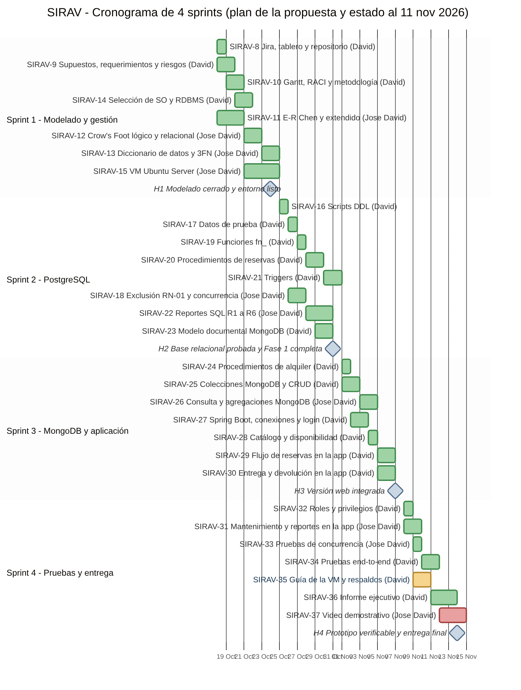
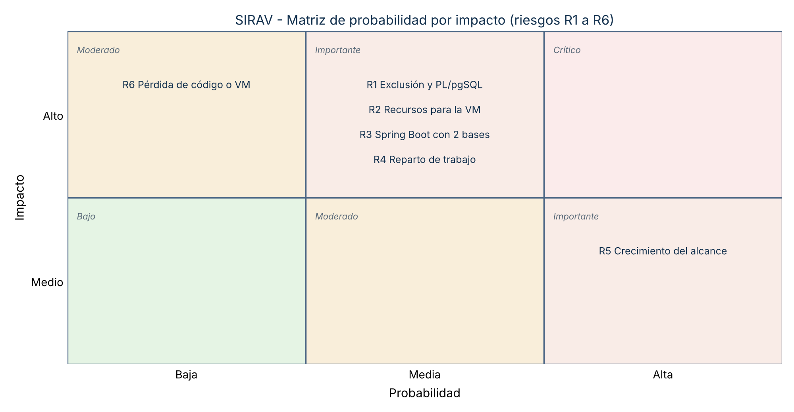

# Documento de gestión del proyecto — SIRAV

Historia de Jira: **SIRAV-10**. Es el documento que anuncian las secciones 7.3 y 7.5 de la propuesta: cronograma (Gantt), matriz gráfica de riesgos, roles y metodología.

**Estado al 11 de noviembre de 2026:** la aplicación está desplegada en tres VM de VirtualBox (SIRAV-15) y auditada, con 81 pruebas aprobadas en las VM y 72 pruebas de Java en verde en GitHub Actions. La documentación de cierre está en el PR de entrega final. Quedan pendientes el primer respaldo real de las VM (SIRAV-35) y el video (SIRAV-37).

## 1. Metodología

Metodología **híbrida**, tal como se justifica en la propuesta (7.1):

- **Fase 1 (modelado):** secuencial, tipo cascada. El modelo E-R, el relacional y el diccionario se cierran antes de implementar.
- **Fase 2 (implementación):** Scrum ligero en **Jira** (proyecto SIRAV, tablero 2), con cuatro sprints semanales y revisión conjunta al terminar cada semana. David Felipe Bejarano Montes es el Product Owner y Jose David Rodriguez el Scrum Master; los roles pueden rotar.
- **Definición de terminado:** código o script en GitHub (`develop`), probado en la VM, revisado por el otro integrante y con evidencia guardada en `docs/`.
- **Control de versiones:** ramas `main`, `develop` y `feature/SIRAV-<n>`, con PR revisados (ver [`CONTRIBUTING.md`](../../CONTRIBUTING.md)).

## 2. Cronograma

**Colores:** verde = trabajo terminado (implementado o redactado); amarillo = en curso; rojo = pendiente. Los rombos son los hitos. Fuente editable: [`gantt.mmd`](gantt.mmd) (Mermaid).

| Sprint | Fechas del plan | Meta | Hito |
|---|---|---|---|
| 1 | 18 al 24 oct | Propuesta, gestión, modelos E-R y relacional, diccionario, selección de SO y RDBMS, VM | **H1** Modelado cerrado y entorno inicial listo |
| 2 | 25 al 31 oct | Scripts de PostgreSQL, restricción RN-01, reportes SQL y modelo documental | **H2** Base relacional probada y Fase 1 completa |
| 3 | 1 al 7 nov | MongoDB, aplicación Spring Boot con catálogo, reservas y alquileres | **H3** Versión web integrada |
| 4 | 8 al 14 nov | Pruebas, roles, guía de la VM, informe y video | **H4** Prototipo verificable y entrega final |

Las fechas son las del plan de la propuesta (4 semanas desde el 18 de octubre). La propuesta indica que las fechas oficiales de cada fase se ajustan al calendario del curso.

## 3. Roles y responsabilidades

| Actividad | David Felipe Bejarano Montes | Jose David Rodriguez |
|---|---|---|
| Modelado y diccionario de datos | C | A/R |
| Scripts de creación e inserción, procedimientos y funciones | A/R | C |
| Restricción de exclusión y pruebas de concurrencia | R | A/R |
| Triggers y roles | A/R | C |
| Reportes SQL | C | A/R |
| MongoDB: modelo documental y CRUD | A/R | C |
| MongoDB: consulta compleja y agregaciones | C | A/R |
| Aplicación web: base, catálogo, reservas y alquileres | A/R | C |
| Aplicación web: mantenimiento y reportes | C | A/R |
| Máquina virtual y guía de despliegue | R | A/R |
| Jira, Gantt, requerimientos, riesgos y pruebas end-to-end | A/R | R |
| Informe ejecutivo | A/R | C |
| Video y sustentación | R | A/R |

R = ejecuta, A = responde por el resultado, C = consultado. Es la misma matriz de la propuesta versión 1.1 (Tabla 14), alineada con las asignaciones de Jira.

## 4. Riesgos

El detalle de cada riesgo y su mitigación está en [`docs/fase-1/matriz-riesgos.md`](../fase-1/matriz-riesgos.md).

**Seguimiento al 11 de noviembre:**

| Riesgo | Estado |
|---|---|
| R1 Restricciones de exclusión y PL/pgSQL | Mitigado: RN-01 con exclusión GiST y `FOR UPDATE`, probada con dos hilos simultáneos |
| R2 Recursos para la VM | Mitigado: tres VM de 2 GB en lugar de una de 6 GB |
| R3 Integración de Spring Boot con dos bases | Ocurrió y se resolvió: error de permisos del usuario de MongoDB corregido; patrón outbox para tolerar caídas |
| R4 Reparto de trabajo en un equipo de dos | A completar por el equipo |
| R5 Crecimiento del alcance | Ocurrió de forma controlada: los supuestos v2.0 agregaron cuentas, historial, cargos y fotos, todo trazado y probado |
| R6 Pérdida de código o de la VM | Mitigado en parte: política y scripts de respaldo de las tres VM; falta el primer respaldo real |
| R7 Dos versiones del esquema en paralelo | Ocurrió y se resolvió: se adoptó el esquema de la aplicación como único |

## 5. Herramientas

| Herramienta | Uso |
|---|---|
| Jira (proyecto SIRAV) | Backlog, sprints, historias y su estado; backlog inicial en [`SIRAV_Jira_backlog.csv`](SIRAV_Jira_backlog.csv) |
| GitHub (`DavidBejarano309/SIRAV`) | Código, scripts, documentos, revisión por PR e integración continua (GitHub Actions) |
| Mermaid y Python | Gantt (`gantt.mmd`) y matriz de riesgos |
